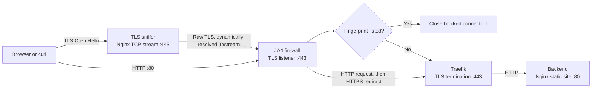

# JA4 Lab

A local Docker Compose lab that fingerprints TLS clients with JA4, checks the
fingerprints against a file-backed blocklist, and forwards allowed connections
to a static web backend through Traefik.

> **Scope:** This is a development and learning lab, not a production-ready
> firewall. The firewall uses Flask's development server for its HTTP listener,
> the default Traefik certificate is self-signed, and the Traefik dashboard is
> exposed without authentication. Do not expose this stack to an untrusted
> network.

## Contents

- [Architecture and request flow](#architecture-and-request-flow)
- [Prerequisites](#prerequisites)
- [Start the lab](#start-the-lab)
- [Open the site](#open-the-site)
- [Configure the JA4 blocklist](#configure-the-ja4-blocklist)
- [Operate the services](#operate-the-services)
- [Tests and validation](#tests-and-validation)
- [Troubleshooting](#troubleshooting)
- [Project layout](#project-layout)

## Architecture and request flow



### HTTPS connection

1. The client connects to host port `443`, published by the Nginx TLS sniffer.
2. The sniffer passes the raw TCP/TLS stream to `ja4-firewall:443`. It uses
   Docker's embedded DNS resolver so a firewall container recreated with a new
   IP can still be found.
3. The firewall peeks at the TLS ClientHello without consuming it, calculates
   a JA4 fingerprint, logs the fingerprint and JA4C, and checks the blocklist.
4. A matching client connection is closed before TLS is forwarded. An allowed
   connection is tunneled unchanged to Traefik on port `443`.
5. Traefik terminates TLS using its default, self-signed certificate, routes
   the hostname to the backend, and sends HTTP to Nginx.

Because a blocked TLS connection is closed during the handshake, clients
typically report a TLS/SSL handshake error rather than receiving an HTTP 403
page.

### HTTP connection

Host port `80` reaches the firewall's Flask HTTP listener. HTTP requests do
not contain a TLS ClientHello and therefore have no JA4 fingerprint to check
at this point. The firewall forwards them to Traefik, which redirects them to
HTTPS. The subsequent HTTPS connection is checked by the TLS listener.

The backend is not published on a host port. Requests must use the firewall
and TLS-sniffer entry points to follow the intended route.

## Prerequisites

- Docker Desktop running with the Linux container engine enabled.
- Docker Compose v2 (`docker compose`).
- Ports `80`, `443`, and `8080` available on the host.

## Services and ports

| Service | Purpose | Host access |
| --- | --- | --- |
| `tls-sniffer` | Nginx TCP stream proxy that forwards TLS to the firewall. | `443` |
| `ja4-firewall` | Computes JA4 fingerprints, applies the blocklist, and forwards allowed traffic. Also accepts HTTP on port 80. | `80` |
| `reverse-proxy` | Traefik routes HTTPS by hostname and terminates TLS. HTTP is redirected to HTTPS. | `8080` for the dashboard/API; ports 80/443 are internal |
| `backend` | Nginx serving the static page in `backend/html/`. | Internal port 80 only; no host port is published |
| `decision-engine` | Standalone Flask `/check` decision endpoint on internal port 5002. It is not currently called by the firewall. | Internal port 5002 only |
| `test-client` | Alpine container kept alive for manual network diagnostics. | No host port |

## Start the lab

From the repository root in PowerShell:

```powershell
docker compose up --build -d
docker compose ps
```

Compose builds the JA4 firewall, TLS sniffer, and decision-engine images, then
starts all services. The backend and test client use published images.

## Open the site

The HTTPS router accepts `localhost`, `secure.local`, and `backend.local`.
`localhost` needs no hosts-file entry:

```text
https://localhost
```

For the named local domains, add these lines to the Windows hosts file
(`C:\Windows\System32\drivers\etc\hosts`) using an editor running as
Administrator:

```text
127.0.0.1 secure.local
127.0.0.1 backend.local
```

Then open `https://secure.local` or `https://backend.local`.

Traefik's default TLS certificate is self-signed. Browsers will warn that the
connection is not trusted unless you configure and trust a local certificate
yourself. This repository does not install a certificate authority. For local
curl smoke tests, `-k` skips certificate verification:

```powershell
curl.exe -k -v https://localhost/
curl.exe -k -v https://secure.local/
```

To check the HTTP-to-HTTPS redirect and follow it:

```powershell
curl.exe -k -L -v http://localhost/
```

The Traefik dashboard/API is published on port `8080`:

```text
http://localhost:8080/dashboard/
```

It is intentionally unauthenticated in this lab; keep it on a trusted local
machine.

## Configure the JA4 blocklist

Edit [`ja4-firewall/blocklist.txt`](ja4-firewall/blocklist.txt). Add one entry
per line:

- **JA4C hash:** exactly 12 hexadecimal characters. This blocks any full JA4
  fingerprint with that JA4C hash.
- **Full JA4 fingerprint:** `client-string_ja4c-hash_extensions-hash`. This
  blocks only that complete fingerprint.

Matching is case-insensitive. Blank lines and comments are ignored. A comment
starts with `#`; entries can also have an inline comment after `#`.

Example:

```text
# Block every client with this JA4C hash
2b729b4bf6f3

# Block only this full JA4 fingerprint
# t13d201261_2b729b4bf6f3_36bf25f296df
```

The example entries above are comments and are **not active**. Uncomment an
entry to enable it. The checked-in blocklist currently has no active entries.

The file is mounted read-only into the firewall and loaded when the firewall
starts. After editing it, restart the firewall:

```powershell
docker compose restart ja4-firewall
```

Check the firewall output to confirm what it loaded and what it matched:

```powershell
docker compose logs --tail 100 ja4-firewall
```

The TLS listener logs lines for the connection, full fingerprint, JA4C, and
`BLOCKED` decision when a fingerprint matches. A blocklist entry only affects
TLS connections that pass through port `443`; ordinary HTTP has no TLS
fingerprint of its own.

## Operate the services

Show status:

```powershell
docker compose ps
```

Follow logs for the request path:

```powershell
docker compose logs -f ja4-firewall tls-sniffer reverse-proxy backend
```

Restart one service:

```powershell
docker compose restart ja4-firewall
```

Rebuild and recreate a service after changing its source or Dockerfile:

```powershell
docker compose up --build -d ja4-firewall tls-sniffer
```

Stop the lab:

```powershell
docker compose down
```

`docker compose down` stops and removes the containers and Compose network; it
does not delete source files or the blocklist.

## Tests and validation

Run the blocklist parser and matching tests from the repository root:

```powershell
python -m unittest discover -s ja4-firewall\python\test -p test_blocklist.py -v
```

Validate the Compose file:

```powershell
docker compose config --quiet
```

Smoke-test an allowed HTTPS request. `-k` is required with the default
self-signed certificate:

```powershell
curl.exe -k -L -v https://localhost/
```

Test a blocklist change by adding the fingerprint observed in the firewall
logs, restarting the firewall, and repeating the HTTPS request. A blocked
fingerprint should fail its TLS handshake; an unlisted fingerprint should
reach the backend and return HTTP `200`.

## Troubleshooting

### HTTPS fails before reaching the site

Inspect the firewall and TLS-sniffer logs:

```powershell
docker compose logs --tail 100 ja4-firewall tls-sniffer
```

Confirm the firewall has its TLS listener and that the sniffer resolves the
service:

```powershell
docker exec ja4-firewall python -c "from python.blocklist import load_blocklist; print(sorted(load_blocklist('/app/blocklist.txt')))"
docker exec ja4_lab-tls-sniffer-1 sh -c "getent hosts ja4-firewall; nginx -t"
```

If the firewall was recreated, make sure the current TLS-sniffer configuration
is in use. It should contain `resolver 127.0.0.11 valid=10s` and proxy to
`ja4-firewall:443` through a variable. This avoids a stale IP after Docker
assigns the firewall container a new address.

### Browser shows a certificate warning

The warning is expected with Traefik's default self-signed certificate. `curl
-k` is suitable for a local smoke test, but it does not make the certificate
trusted in a browser. For browser trust, provision a certificate for the
hostname and trust its issuing CA on the local machine; do not use a
self-signed or lab CA on a production deployment.

### HTTP returns a redirect

That is expected. Port `80` redirects to HTTPS. Make sure the HTTPS request
uses one of the configured names: `localhost`, `secure.local`, or
`backend.local`.

### Port is already allocated

Another process or container may be using `80`, `443`, or `8080`. Identify and
stop only the conflicting service, or change the published host port in
[`docker-compose.yml`](docker-compose.yml) and use the corresponding URL.

### Find the JA4 fingerprint for a client

Make a new HTTPS connection and inspect the firewall logs:

```powershell
curl.exe -k https://localhost/
docker compose logs --tail 50 ja4-firewall
```

The firewall prints a fingerprint for each newly inspected TLS connection;
reused browser connections do not create a new handshake or a new fingerprint
log.

## Project layout

| Path | Purpose |
| --- | --- |
| [`docker-compose.yml`](docker-compose.yml) | Defines services, port publishing, mounts, and the Compose network. |
| [`ja4-firewall/app.py`](ja4-firewall/app.py) | Flask HTTP forwarding and raw TLS ClientHello inspection/blocking. |
| [`ja4-firewall/blocklist.txt`](ja4-firewall/blocklist.txt) | User-maintained JA4C hashes and full JA4 fingerprints. |
| [`ja4-firewall/python/blocklist.py`](ja4-firewall/python/blocklist.py) | Blocklist parser, validation, and matching rules. |
| [`ja4-firewall/python/`](ja4-firewall/python/) | JA4 and related fingerprint implementations. |
| [`ja4-firewall/python/test/`](ja4-firewall/python/test/) | Unit and PCAP-based tests for fingerprint functionality. |
| [`tls-sniffer/nginx.conf`](tls-sniffer/nginx.conf) | TCP/TLS stream forwarding with dynamic Docker DNS resolution. |
| [`traefik/dynamic.yml`](traefik/dynamic.yml) | Host-based HTTPS routes and backend service definition. |
| [`backend/html/`](backend/html/) | Static page served by the backend Nginx container. |
| [`decision-engine/app.py`](decision-engine/app.py) | Standalone HTTP decision endpoint on the internal Compose network; not currently called by the JA4 firewall. |
| [`backend/app.py`](backend/app.py) | Flask example backend; Compose currently serves the static Nginx site instead. |
